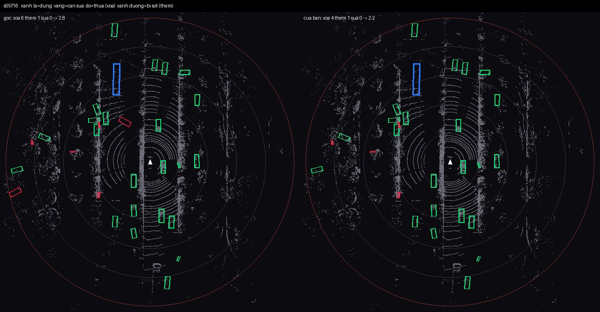

# Báo cáo Day 14 — Dao Quang Tuan — 2A202603194


- Mã học viên dùng với `--student`: `194`
- `seed_tag` trong `frames_A.txt`: `393590736f`

## 1. Dự đoán trước sweep (bước 5b)

Ghi **trước** khi chạy `scripts/pp_sweep.py`, rồi commit và push ngay (lịch sử commit là bằng chứng thời điểm viết). Không sửa phần này sau khi có kết quả.

> **Trạng thái: học viên đã duyệt (2026-11-27).** Bản này do trợ lý AI (Claude Code) soạn theo yêu cầu của học viên, chỉ dựa trên `pred_A.json`, `ref_A.json` và ảnh BEV tập A ở cấu hình gốc, **trước khi** chạy `scripts/pp_sweep.py`. Học viên đã đọc và duyệt nội dung trước khi commit.

- Tham số tôi nghĩ giảm công sửa nhiều nhất: **`min_points`**, nâng lên khoảng **5** và giữ `score_thr` ở mức thấp (0.1–0.2). Dự đoán: nâng `score_thr` lên ≥ 0.3 sẽ làm **tăng** chi phí.
- Vì sao (nhìn ảnh BEV tập A: box thừa nhiều hay box sót nhiều?):
  - Cấu hình gốc: 7 box thừa (7 × 0.3 = 2.1) và 3 box sót (3 × 1.0 = 3.0), tổng 5.1. Box sót chiếm phần lớn chi phí, mà cả hai tham số chỉ **lọc bớt** box nên không thể giảm phần "thêm". Vì vậy sweep chỉ cắt được tối đa 2.1.
  - Score của 7 box thừa nằm trong khoảng 0.27–0.50, trộn lẫn với box đúng (trung vị score toàn bộ 87 box là 0.44). Có 14 box score < 0.3 nhưng chỉ 1 box trong đó là box thừa, nên `score_thr=0.3` có thể xóa nhầm khoảng 13 box đúng. Mỗi box đúng bị mất biến thành 1 lần "thêm" (1.0), đắt hơn hẳn 0.3 tiết kiệm được.
  - Hai box thừa ở s05f16 gần như không có điểm LiDAR: Car `pp_id` 25 (1 điểm, đè lên cabin xe ben) và Car `pp_id` 21 (2 điểm, trong bụi cây 47.9 m). `min_points=5` lọc được cả hai, dự kiến tiết kiệm khoảng 0.6. Trong tập A chỉ có 2 box dưới 5 điểm, nên ít rủi ro mất box đúng.
  - `min_points=10` rủi ro hơn: có 6 box dưới 10 điểm, trong đó 4 box không nằm trong danh sách box thừa (có thể là xe hoặc người ở xa).
  - Các box thừa còn lại không lọc được bằng hai tham số này: 2 box bao chính xe ghi dữ liệu (score 0.44–0.46, hơn 500 điểm) và Cyclist trên hàng rào / nhà chờ (86–188 điểm).
- Tác động dự kiến: chi phí tập A giảm từ 5.1 xuống khoảng **4.5** (khoảng −12%), không thể xuống dưới khoảng 3.0 vì 3 box sót (Bus, xe ben, Pedestrian) không phụ thuộc tham số lọc.
- Rủi ro: chỉ 3 frame tune, nên 2 box ít điểm ở một frame (s05f16) quyết định kết quả; leave-one-out có thể cho thấy cấu hình không ổn định. Ở tập B, người hoặc xe đạp ở xa có thể có dưới 5 điểm và bị lọc nhầm.

## 2. Tập A: sửa tay và tune

| Cấu hình | Xóa | Thêm | Sửa | Chi phí |
|---|---:|---:|---:|---:|
| Gốc | 22 | 3 | 0 | 9.6 |
| `best_config.json` | 20 | 3 | 0 | 9.0 |

Số đo gốc từ `scripts/pp_prelabel.py --frames d14_194/frames_A.txt --gt d14_194/ref_A.json`: GT 68, dự đoán 87, khớp 65 (s02f27: xóa 7 thêm 1 → 3.1; s03f31: xóa 9 thêm 1 → 3.7; s05f16: xóa 6 thêm 1 → 2.8).

> **`ref_A.json` có 2 phiên bản.** Bản 1 (83 box, commit `9993409`, dùng để viết dự đoán 5b ở mục 1): chi phí gốc 5.1 → `best_config` 4.5. Sau khi gán nhãn tập B, tôi kiểm lại 18 box Cyclist của tập A trên camera và thấy 15 box nằm trên bụi cây/nhà chờ, không có người lái (guideline: xe hai bánh không người thì không vẽ). Tôi đã xóa 15 box này trên CVAT (`out/edit_A/apply_A.log`), xuất lại `ref_A.json` (bản 2, 68 box) và chạy lại sweep + compare. Mọi số trong mục 2–3 và Phụ lục D là của bản 2. Bản 1 giữ ở `out/ref_A_truoc_xoaCyclist.json`, sweep cũ ở `out/sweep_A_v1.csv`. Cấu hình tốt nhất không đổi giữa hai bản.

- **3 box thêm:** Bus ở s03f31 và Truck (xe ben) ở s05f16, hai xe lớn model KITTI không phát hiện; Pedestrian ở nhà chờ xe buýt s02f27 (model đoán Cyclist `pp_id` 19 dài 2.13 m; box đúng chỉ 0.6 × 0.6 m nên BEV IoU < 0.3, scorer tính là 1 xóa + 1 thêm).
- **22 box xóa (cấu hình gốc):** 18 Cyclist và 4 Car.
  - 15 Cyclist không có người lái (bụi cây, nhà chờ).
  - Cyclist `pp_id` 26 trên hàng rào ở s02f27, Cyclist `pp_id` 19 nói trên, Cyclist `pp_id` 16 cách 21.1 m ở s05f16.
  - 2 box Car bao chính xe ghi dữ liệu (tâm cách LiDAR 0.3–0.4 m; `pp_id` 14 ở s02f27, `pp_id` 8 ở s03f31).
  - Ở s05f16: Car `pp_id` 25 đè lên cabin xe ben (1 điểm LiDAR trong hộp), Car `pp_id` 21 trong bụi cây cách 47.9 m (2 điểm).
- Box thừa chiếm phần lớn chi phí (22 × 0.3 = 6.6), so với box sót (3 × 1.0 = 3.0). Model KITTI gán Cyclist cho nhiều cụm điểm nhỏ dạng thẳng đứng ven đường.

- Tham số đã đổi trong `best_config.json`: `min_points: 0 → 5`. `score_thr` giữ 0.1 (mặc định). Sweep lưới `score_thr ∈ {0.1, 0.2, 0.3, 0.4, 0.5}` × `min_points ∈ {0, 5, 10}` = 15 cấu hình × 3 frame, chạy 60 s trên CPU (log `out/logs/sweep_A.log`). Với `best_config.json`: GT 68, dự đoán 85, khớp 65.
- Kết quả sweep chính (đủ ở `d14_194/sweep.csv`):

  | `score_thr` | `min_points` | Xóa | Thêm | Chi phí |
  |---:|---:|---:|---:|---:|
  | 0.1 / 0.2 | 5 | 20 | 3 | **9.0** |
  | 0.1 / 0.2 | 0 | 22 | 3 | 9.6 |
  | 0.1 / 0.2 | 10 | 20 | 7 | 13.0 |
  | 0.3 | 0 / 5 / 10 | 18 / 16 / 16 | 13 / 13 / 16 | 18.4 / 17.8 / 20.8 |
  | 0.4 | 0 / 5 / 10 | 14 / 13 / 13 | 29 / 29 / 30 | 33.2 / 32.9 / 33.9 |
  | 0.5 | 0 / 5 / 10 | 5 | 39 | 40.5 |

  Sửa = 0 ở mọi cấu hình.

  `score_thr` 0.1 và 0.2 cho kết quả giống hệt vì box có score thấp nhất trong `pred_A.json` là 0.216. Sweep chọn 0.1 (dòng đầu trong các dòng hòa), đúng bằng mặc định.
- Kết quả leave-one-out (dán các dòng `scripts/pp_sweep.py` in ra):

  ```
  s02f27: cấu hình chọn {'score_thr': '0.1', 'min_points': '5'} → 3.1 (tốt nhất có thể 3.1)
  s03f31: cấu hình chọn {'score_thr': '0.1', 'min_points': '5'} → 3.7 (tốt nhất có thể 3.7)
  s05f16: cấu hình chọn {'score_thr': '0.1', 'min_points': '5'} → 2.2 (tốt nhất có thể 2.2)
  ```
- Cấu hình có ổn định trên từng frame không? Có: bỏ bất kỳ frame nào ra, 2 frame còn lại vẫn chọn cùng cấu hình, và cấu hình đó đạt chi phí tốt nhất có thể trên frame bị bỏ ra. Nhưng toàn bộ mức giảm (0.6) đến từ **một frame** (s05f16, 2 box Car 1–2 điểm), còn s02f27 và s03f31 không đổi. Bằng chứng ổn định vì vậy còn mỏng. Vẫn chọn vì `min_points=5` không làm mất box đúng nào trên tập A (số "thêm" giữ nguyên 3) và có lý do vật lý rõ ràng: hộp gần như không có điểm LiDAR thì không phải vật thật. `min_points=10` đã làm mất 4 box đúng, nên ngưỡng 5 là giới hạn an toàn. Hai tham số này không xử lý được lỗi lớn nhất (Cyclist không người lái có score và số điểm lẫn với box đúng): `score_thr=0.3` bớt được 6 box xóa nhưng mất thêm 10 box đúng.

## 3. Trước/sau (bước 8)

> Trợ lý AI soạn mục này từ output thật của `scripts/pp_compare.py` (log `out/logs/compare_A.log`); xem khai báo ở Phụ lục C.



*s05f16, trái: cấu hình gốc (xóa 6, thêm 1 → 2.8); phải: `best_config.json` (xóa 4, thêm 1 → 2.2). Xanh lá = đúng, đỏ = thừa (xóa), xanh dương = bị sót (thêm).*

- `scripts/pp_compare.py` báo **giảm 6%** công sửa trên tập A (9.6 → 9.0, tham số đổi: `min_points: 0 → 5`). Theo frame: s02f27 3.1 → 3.1, s03f31 3.7 → 3.7, s05f16 2.8 → 2.2. Đây là chi phí theo công thức trên 3 frame tune (cũng là 3 frame dùng để chọn cấu hình), không phải thời gian sửa thật. Số đo trên dữ liệu mới ở mục 4.
- Dự đoán ở mục 1 đúng hay sai? **Đúng về tham số và cơ chế, sai về con số tương đối.**
  - Mục 1 dự đoán `min_points ≈ 5` là cấu hình tốt nhất và mức giảm tuyệt đối 0.6 (5.1 → 4.5). Kết quả: đúng `min_points=5`, giảm đúng 0.6, do đúng hai box Car ít điểm ở s05f16 (`pp_id` 25, 1 điểm; `pp_id` 21, 2 điểm) bị lọc, thấy ở ảnh trên (hai hộp đỏ biến mất ở cột phải). Số thêm giữ nguyên 3, sửa 0, nên không mất box đúng nào.
  - Mục 1 dự đoán `score_thr ≥ 0.3` làm chi phí tăng: đúng, số thêm tăng 3 → 13 (chi phí 17.8).
  - Con số "−12%" không còn đúng: dự đoán dựa trên `ref_A.json` bản 1, còn 15 Cyclist không người lái. Khi sửa nhãn (mục 2), 15 box đó thành box xóa ở mọi cấu hình, nên mẫu số tăng từ 5.1 lên 9.6 và mức giảm tương đối còn 6%. Mục 1 cũng nói chi phí "không thể xuống dưới khoảng 3.0" vì 3 box sót; điều này vẫn đúng (thêm = 3 ở cấu hình tốt nhất), nhưng tôi đã không thấy trước rằng phần lớn chi phí là Cyclist thừa mà hai tham số này không lọc được.

## 4. Tập B

Số đo từ `scripts/pp_prelabel.py --frames d14_194/frames_B.txt --config d14_194/best_config.json --gt d14_194/ref_B.json` (log `out/logs/score_B.log`):

| Cấu hình | GT | Pred | Khớp | Xóa | Thêm | Sửa | Chi phí |
|---|---:|---:|---:|---:|---:|---:|---:|
| `best_config.json` | 275 | 379 | 265 | 114 | 10 | 0 | **44.2** |
| Gốc (đối chứng, `out/logs/score_B_default.log`) | 275 | 387 | 265 | 122 | 10 | 0 | 46.6 |

- `best_config.json` giảm 5% so với cấu hình gốc trên 12 frame chưa dùng để tune (46.6 → 44.2, bớt 8 box xóa, không mất box đúng). Mức này gần bằng 6% ở tập A, nên cấu hình chuyển sang dữ liệu mới mà không mất tác dụng, nhưng tác dụng nhỏ.
- Loại box tốn công sửa nhất ở tập B: **Cyclist thừa.**
  - 88 trong 114 box xóa là Cyclist (26.4 / 44.2 điểm chi phí, 60%). Gần hết là cụm điểm dạng thẳng đứng ven đường (bụi cây, gốc cây, cột, nhà chờ, xe đạp dựng) mà model KITTI gán Cyclist. `pred_B` có 115 Cyclist, `ref_B` chỉ giữ 27.
  - 26 box xóa còn lại là Car. 12 trong số đó là box bao chính xe ghi dữ liệu (mỗi frame 1 box), còn lại là box ít điểm trong bụi cây/hàng rào hoặc đè lên xe buýt.
  - 10 box thêm (10.0 điểm, 23%): 5 Bus, 4 Pedestrian, 1 SUV. Model không có lớp Bus nên không xe buýt nào được phát hiện.
  - Sửa = 0: 265 box khớp được giữ nguyên hình học. Kích thước của các box Car nhỏ không được chỉnh lại theo Bảng 4.3 (xem mục 5).
- Gợi ý cho lần sau: lọc box chính xe ghi dữ liệu (tâm < 1.5 m) và hạ trọng số Cyclist không có cụm điểm người ở độ cao 1–1.9 m sẽ cắt được phần lớn chi phí, điều mà `score_thr`/`min_points` không làm được.

## 5. Giới hạn

- **Chỉ 3 frame để tune.** Tập A có 83 box tham chiếu nhưng chỉ 10 thao tác xóa/thêm. Với ít lỗi như vậy, một box thay đổi cũng làm chi phí lệch rõ, nên cấu hình "tốt nhất" dễ overfit; cần đọc leave-one-out trước khi tin.
- **Model học trên KITTI** (LiDAR 64 tia, chỉ phía trước, 3 lớp Car/Pedestrian/Cyclist). Model không biết Truck/Bus: cả 2 box phải thêm ở tập A đều là xe lớn (Bus, xe ben). Luật đổi lớp theo kích thước không cứu được box mà model không phát hiện.
- **Chi phí là công thức** (`0.3·xóa + 1.0·thêm + 0.5·sửa`), không phải thời gian sửa thật, nên không quy ra "giờ công tiết kiệm".
- **Chỉ tính box trong 50 m** và ghép bằng BEV IoU ≥ 0.3. Vật ở xa hơn 50 m hoặc lệch ít hơn ngưỡng sửa (0.3 m, 0.2 m, 10°) không được tính.
- **`ref_*.json` là nhãn tôi tự sửa**, không phải ground truth chính thức. Một số vật ở xa, nhiều cây che (ví dụ một xe tải cách khoảng 49 m ở s05f16) khó xác định nên có thể còn sót.
- **Phần lớn chỉnh sửa trên CVAT do trợ lý AI thực hiện qua API theo yêu cầu của tôi** (Phụ lục C), dựa trên ảnh camera và cụm điểm LiDAR. Các box AI thêm ở tập B mang `note = AI_DRAFT`. Khoảng 20 Cyclist bị che/ở xa được giữ vì không kết luận được; nếu không có người lái thì chi phí B sẽ cao hơn khoảng 6 điểm.
- **Không chỉnh hình học box đã khớp** (sửa = 0 ở cả A và B). Box Car nhỏ hơn Bảng 4.3 vẫn giữ kích thước của model, nên "sửa" có thể bị đếm thiếu.
- **`ref_A.json` đổi sau commit 5b** (mục 2): dự đoán ở mục 1 dựa trên bản 1, nên con số tương đối ở mục 3 không so trực tiếp được.

> ✍️ Phần dưới là phụ lục kỹ thuật, lấy từ code và số đo thực tế. Ký hiệu ⏳ = chờ số đo; ✍️ = học viên tự viết/xác nhận.

## Phụ lục A. Pipeline

1. **Chọn frame:** `vf_cvat.py day14` sinh `frames_A.txt` (3 frame tune) và `frames_B.txt` (12 frame nộp) từ mã học viên `194` + SEED (`seed_tag=393590736f`). Không sửa tay.
2. **Model:** PointPillars pre-trained KITTI ([zhulf0804/PointPillars](https://github.com/zhulf0804/PointPillars) `620e6b0`), chạy CPU. Voxelize và rotated NMS là bản Python thuần (`vf_pp/upstream.py`).
3. **Đổi miền VF → KITTI:** `x_kitti = −y_vf`, `y_kitti = x_vf`. Model chỉ nhìn 90° phía trước nên mỗi frame chạy 4 lượt xoay (`passes=4`) để phủ 360°, rồi gộp bằng NMS (`merge_nms_thr`).
4. **Hậu xử lý:** lọc `score_thr`, `min_points`, `range_m=50`. Box Car dài/cao được đổi lớp thành Truck/Bus theo luật kích thước (`truck_l_min`, `bus_l_min`…).
5. **Sửa tay trên CVAT:** pre-label đưa lên task `D14-194-A/B` kèm thuộc tính `pp_id`, `score`, `warn`, `note`. Người gán nhãn xóa/thêm/sửa rồi Save. `vf_cvat.py reference` xuất `ref_*.json`.
6. **Tune:** `pp_sweep.py` grid `score_thr × min_points` trên tập A so với `ref_A.json`, kèm leave-one-out.
7. **Áp dụng:** `best_config.json` → `pred_B.json` → task B → sửa tay → `ref_B.json`.

Tái lập đã kiểm: chạy lại bước 2 trên tập A cho kết quả trùng khớp `pred_A.json`. Selftest `TẤT CẢ OK`. `pytest` (chạy lại 2026-11-27): 49/51 test pass; 2 test fail trong `tests/test_student_guide_deliverables.py` vì repo không còn file `RULES.md` (test kiểm tài liệu đề, không kiểm sản phẩm nộp).

## Phụ lục B. Phương pháp đo

- Chi phí sửa = `0.3·xóa + 1.0·thêm + 0.5·sửa`, chỉ tính box có tâm ≤ 50 m (BEV).
- Ghép pred–ref khi BEV IoU ≥ 0.3. Box đã ghép vẫn tính "sửa" nếu sai lớp, tâm lệch > 0.3 m, một kích thước lệch > 0.2 m hoặc phương trục dài lệch > 10° (coi 180° là cùng phương).
- `ref_*.json` là **nhãn tham chiếu do tôi sửa**, không phải ground truth chính thức. Chi phí là công thức, không phải thời gian sửa thật.

## Phụ lục C. Công cụ hỗ trợ ngoài pre-label của lab (khai báo)

✍️ Xác nhận công cụ nào bạn thực sự đã dùng, xóa dòng không dùng:

- `tools/d14_assist.py bev`: vẽ ảnh BEV có số `pp_id` và đánh dấu "M#" ở cụm điểm không có box (ứng viên bị sót). Chỉ là gợi ý. Mọi box đều do tôi xác nhận bằng camera rồi vẽ/sửa tay.
- `tools/d14_assist.py notes`: ghi gợi ý vào thuộc tính `note` của cuboid. Không đổi tọa độ, kích thước, lớp.
- `tools/d14_camserver.py` + `tools/cvat-d14-cameras.user.js`: chiếu cuboid đã Save lên 7 camera để kiểm. Chỉ đọc, không ghi nhãn.
- `tools/d14_draft.py`: tìm cụm điểm LiDAR chưa có box, chiếu lên camera để lọc. Trên tập A, 32 ứng viên chỉ có 1 vật thật (xe ben ở s05f16, cách 28.6 m); phần còn lại là nhà chờ, hàng cây, biển quảng cáo. Box này được đẩy lên CVAT dưới dạng nháp (`note = AI_DRAFT - can kiem`, lớp Truck). Tôi đã kiểm và chỉnh box này trên CVAT (dời tâm từ (10.91, −26.42) sang (11.61, −28.69), xoay yaw 1.452 → 1.560) rồi mới xuất `ref_A.json`.
- Kiểm tra QA tự động trên tập A (Claude Code): so kích thước với Bảng 4.3, đếm điểm LiDAR trong hộp, chiếu hộp nghi vấn lên camera. Theo yêu cầu của tôi, công cụ đã sửa trực tiếp trên CVAT 4 lỗi thấy rõ trên camera: xóa box Car bao chính xe ghi dữ liệu (s03f31), xóa box Car trong bụi cây cách 47.9 m (s05f16), xóa box Car trùng cabin xe ben (s05f16), đổi chiều rộng Bus từ 3.11 m thành 2.55 m (s03f31). Lần 2 sửa thêm 2 box ở s02f27: xóa Cyclist trên hàng rào (camera không có xe), thu Pedestrian ở nhà chờ từ 2.13 m xuống 0.6 × 0.6 × 1.7 m theo cụm điểm của người và hạ đáy sát mặt đường. Đã sao lưu trước mỗi lần sửa (`out/cvat_backup_D14-194-A_truoc_suaQA*_*.json`). ✍️ Tôi đã mở CVAT kiểm lại các thay đổi này.
- Trợ lý AI (Claude Code): chạy lệnh, kiểm tra CVAT/dữ liệu, sửa một phần nhãn tập A qua API theo yêu cầu của tôi (liệt kê đầy đủ ở hai dòng trên), điền bảng số liệu, viết mục 5 và các phụ lục kỹ thuật. Theo yêu cầu của tôi, trợ lý AI cũng soạn dự đoán 5b (mục 1, chỉ dựa trên số liệu tập A ở cấu hình gốc, trước khi chạy sweep) và bản nháp đối chiếu ở mục 3. Tôi đã duyệt mục 1 trước khi commit `5b: dự đoán` (`9993409`, push lúc 2026-11-27 12:08 +07:00); sweep chạy sau đó, lúc 12:09.
- Trợ lý AI cũng chạy sweep, `pred_B.json`, tạo task `D14-194-B` (CVAT task 33, 12 frame, 379 cuboid), ghi gợi ý vào thuộc tính `note` của task B (không đổi hình học; sao lưu `out/cvat_backup_D14-194-B.json`) và tạo ảnh BEV gợi ý `out/assist_B/`.
- **Sửa tập B trên CVAT bằng API (theo yêu cầu của tôi, 2026-11-27).** Trợ lý AI chiếu từng box và từng cụm điểm chưa có box lên 7 camera (ảnh ghép `out/sheets_B/`), rồi sửa. Log đầy đủ ở `out/edit_B/apply_B.log`, script ở `out/edit_B/`; sao lưu trước mỗi lần sửa ở `out/cvat_backup_D14-194-B_truoc_*.json`.
  - Xóa 12 box Car bao chính xe ghi dữ liệu (tâm ≤ 1 m từ LiDAR, mỗi frame 1 box).
  - Xóa 17 box ít điểm LiDAR mà camera cho thấy là bụi cây, hàng rào, bãi xe đạp, hoặc box Car đè lên xe buýt.
  - Xóa 85 box Cyclist mà camera không thấy người lái (bụi cây, gốc cây, nhà chờ, xe đạp dựng bên đường). Theo guideline Day 13, xe hai bánh không có người thì không vẽ. Giữ 27 box Cyclist: 7 box thấy rõ người lái, các box còn lại bị xe khác che hoặc quá xa để kết luận.
  - Thêm 10 box (`note = AI_DRAFT - can kiem: ...`): 5 Bus (s01f12, s02f01, s03f53 ×2, s04f28), 1 Car (SUV ở s03f21), 4 Pedestrian (s03f21 ×3, s01f54). Kích thước theo Bảng 4.3, vị trí theo cụm điểm LiDAR, đã chiếu lại lên camera để kiểm; 3 box được tinh chỉnh thêm theo lưới điểm (xe buýt s01f12, SUV s03f21, người s01f54).
  - ✍️ Tôi đã mở CVAT kiểm lại các thay đổi này trước khi xuất `ref_B.json`.
- **Sửa lại tập A sau khi gán B (theo yêu cầu của tôi, 2026-11-27).** Trợ lý AI xóa 15 Cyclist không người lái trên task `D14-194-A` (s02f27 `pp_id` 6, 8, 9, 21; s03f31 `pp_id` 5, 11, 12, 13, 14, 21, 27, 29; s05f16 `pp_id` 11, 18, 28). Giữ 3 box mơ hồ (s03f31 `pp_id` 6; s05f16 `pp_id` 13, 20). Sao lưu `out/cvat_backup_D14-194-A_truoc_xoaCyclist_*.json`, log `out/edit_A/apply_A.log`. Sau đó xuất lại `ref_A.json`, chạy lại sweep, compare; mục 1 không sửa. ✍️ Tôi đã mở CVAT kiểm lại.

## Phụ lục D. Bảng so sánh A/B

| Tập | Cấu hình | GT (ref) | Pred | Khớp | Xóa | Thêm | Sửa | Chi phí |
|---|---|---:|---:|---:|---:|---:|---:|---:|
| A | Gốc | 68 | 87 | 65 | 22 | 3 | 0 | 9.6 |
| A | `best_config.json` | 68 | 85 | 65 | 20 | 3 | 0 | 9.0 |
| B | Gốc (đối chứng) | 275 | 387 | 265 | 122 | 10 | 0 | 46.6 |
| B | `best_config.json` | 275 | 379 | 265 | 114 | 10 | 0 | 44.2 |

Phân tích sai số theo lớp (cấu hình gốc, trong 50 m):

| Tập | Xóa Cyclist | Xóa Car | Thêm Bus/Truck | Thêm Pedestrian | Thêm Car |
|---|---:|---:|---:|---:|---:|
| A | 18 | 4 | 2 | 1 | 0 |
| B | 88 (`best_config`) | 26 (`best_config`) | 5 | 4 | 1 |

Box xóa nhiều nhất là Cyclist; box thêm nhiều nhất là xe lớn (Bus/Truck), lớp model KITTI không có. Không có box sửa ở cả hai tập.
